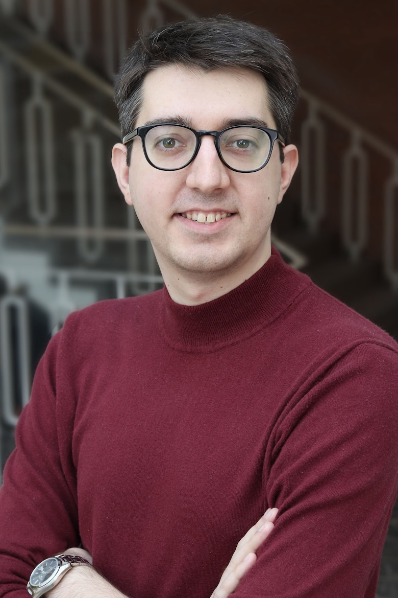

::::: hero
::: hero-copy

PHONETICS · SPEECH PROCESSING · SPEECH PROCESSING

# Dušan Nikolić

Research Scientist  Acoustics Research Institute  Austrian Academy of Sciences (ÖAW), Vienna

I am a **postdoctoral researcher in phonetics and speech science** at the [Acoustics Research Institute, Austrian Academy of Sciences (ÖAW)](https://www.oeaw.ac.at/isf) in Vienna, Austria. I received my PhD in Linguistics, specializing in Phonetics and Speech Sciences, from the University of Calgary. My research explores how humans perceive, represent, and process the sounds and prosodic patterns of language, with a particular interest in the cognitive and neurocognitive mechanisms underlying speech perception and language processing.

## Research Focus & Interests

**Speech Perception and Linguistic Categories.** My research investigates how listeners perceive and organize speech sounds into linguistic categories, how they adapt to variation in spoken language, and how different sources of information shape speech perception. A central question is how listeners extract meaningful linguistic structure from the highly variable acoustic signals of everyday speech.

**Prosody and Spoken-Word Recognition.** I examine how listeners use prosodic information, particularly lexical stress, pitch accent, and duration, to recognize spoken words. My work explores how linguistic experience shapes sensitivity to these cues and how listeners process unfamiliar prosodic systems.

**Cognitive Mechanisms and Individual Differences.** A broader goal of my research is to understand the cognitive and neurocognitive mechanisms that support speech processing, including how listeners integrate acoustic information, adapt to unfamiliar speech patterns, and form and update linguistic categories.

**Language, Communication, and Clinical Perspectives.** I am interested in connecting fundamental research on speech perception with questions about real-life communication and individual differences in language processing, including potential implications for clinical populations. Ultimately, my work seeks to contribute to a better understanding of how the human mind makes sense of spoken language.

:::

::: hero-image

:::
:::::

## Current affiliation

**Acoustics Research Institute (ISF)**

Austrian Academy of Sciences (ÖAW)

Vienna, Austria

[Institutional profile](https://www.oeaw.ac.at/en/ari/team/our-team/nikolic-dusan)
