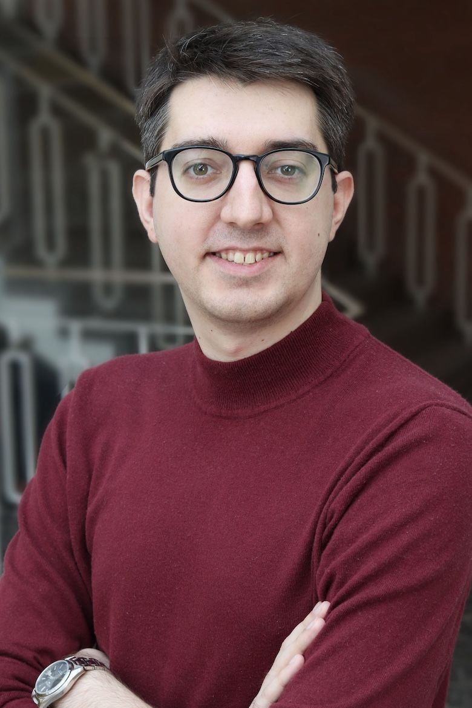

::::: hero
::: hero-copy

PHONETICS · SPEECH PROCESSING · SPEECH PROCESSING

# Dušan Nikolić

Research Scientist  Acoustics Research Institute  Austrian Academy of Sciences (ÖAW), Vienna

I am currently working on the processing of acoustic cues of lexical prosody by native and non-native listeners. My goal is to explore the integration of the acoustic cues of spoken language as it is being processed in speech. I want to understand what happens in the brain until we make specific language decisions and how the choices relate to speech processing.

:::

::: hero-image

:::
:::::

## Research

My overarching research goal is to contribute to an understanding of the architecture of human speech processing.

My work investigates the interaction between acoustic, phonetic and neurocognitive processes involved in speech production and perception.

### Research interests

- **Neurocognition** — how evidence accumulation shapes the moment-by-moment choices in speech perception and production.
- **Variation and variability** — how individual, linguistic, and contextual sources of variation shape speech processing
- **Cross-linguistic effects** — how differences in listners' and speakers' native languages shape speech production and perception.
- **Prosodic representation** — how prosodic information contributes to the recognition and processing of spoken language.

## Current affiliation

**Acoustics Research Institute (ISF)**

Austrian Academy of Sciences (ÖAW)

Vienna, Austria

[Institutional profile](https://www.oeaw.ac.at/en/ari/team/our-team/nikolic-dusan)
